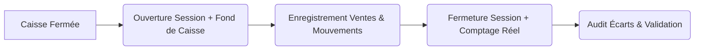

# Guide d'Utilisation Complet - ModaDZ

Ce document regroupe l'intégralité de la documentation utilisateur de **ModaDZ**, l'application de point de vente et de gestion de magasin de vêtements.

## Table des Matières

- [Chapitre 1 : Introduction à ModaDZ](#chapter-1) - *Bienvenue dans le guide dutilisation officiel de ModaDZ, la solution moderne de gestion de point de vente (POS).*
- [Chapitre 2 : Prise en main rapide](#chapter-2) - *Apprenez à configurer rapidement votre boutique et à effectuer votre première vente sur ModaDZ.*
- [Chapitre 3 : Guide d'Installation](#chapter-3) - *Prérequis système et installation du matériel (imprimantes de tickets, douchettes codes-barres).*
- [Chapitre 4 : Authentification & Sessions](#chapter-4) - *Guide sur la connexion sécurisée, la gestion des sessions de caisse et la réinitialisation de mot de passe.*
- [Chapitre 5 : Rôles Utilisateurs](#chapter-5) - *Comprendre la gestion des utilisateurs, les niveaux daccès et les autorisations système de ModaDZ.*
- [Chapitre 6 : Le Tableau de Bord (Dashboard)](#chapter-6) - *Suivez les performances de votre magasin en temps réel grâce aux indicateurs clés de ModaDZ.*
- [Chapitre 7 : L'Écran de Vente (POS)](#chapter-7) - *Guide complet dutilisation de lécran dencaissement et de facturation rapide de ModaDZ.*
- [Chapitre 8 : Gestion des Produits](#chapter-8) - *Comment ajouter, éditer et catégoriser vos articles et gérer les déclinaisons de tailles et couleurs.*
- [Chapitre 9 : Inventaire et Suivi des Stocks](#chapter-9) - *Suivi des niveaux de stock, alertes de rupture, ajustements de stocks et inventaires de contrôle.*
- [Chapitre 10 : Génération & Impression de Codes-barres](#chapter-10) - *Générer des codes-barres automatiques, gérer les impressions détiquettes individuelles ou en lot, et configurer les formats de planches dautocollants.*
- [Chapitre 11 : Gestion des Clients](#chapter-11) - *Gérer votre fichier client, suivre lhistorique dachat, les plafonds de dette et la fidélité.*
- [Chapitre 12 : Historique des Ventes & Retours](#chapter-12) - *Consulter lhistorique des ventes, réimprimer des tickets et traiter les retours darticles.*
- [Chapitre 13 : Gestion des Dettes Clients](#chapter-13) - *Suivre les ardoises clients (crédits), enregistrer les remboursements et gérer les rappels.*
- [Chapitre 14 : Gestion des Dettes Fournisseurs](#chapter-14) - *Suivre les balances fournisseurs, enregistrer les versements de dettes achats et consulter lhistorique des paiements.*
- [Chapitre 15 : Gestion des Dépenses](#chapter-15) - *Suivre les frais généraux de la boutique et enregistrer les sorties de caisse quotidiennes.*
- [Chapitre 16 : Gestion & Suivi de Caisse (Sessions)](#chapter-16) - *Ouvrir et fermer des sessions de caisse, suivre les mouvements de fonds (entrées/sorties) et analyser les écarts de caisse.*
- [Chapitre 17 : Rapports et Exports de Données](#chapter-17) - *Générer des rapports financiers de vente, de marge et de stock et exporter vos données sous format Excel ou PDF.*
- [Chapitre 18 : Gestion des Utilisateurs](#chapter-18) - *Comment créer des comptes pour vos employés, caissiers et gérants et gérer leurs accès.*
- [Chapitre 19 : Sauvegarde et Restauration de Données](#chapter-19) - *Protégez les données de votre boutique en effectuant des sauvegardes régulières et apprenez à restaurer votre base de données.*
- [Chapitre 20 : Configuration & Paramètres](#chapter-20) - *Configurer votre boutique, personnaliser les reçus de caisse, et paramétrer les préférences du point de vente.*
- [Chapitre 21 : Licence Commerciale & Activation](#chapter-21) - *Activer ModaDZ, gérer votre abonnement commercial, comprendre le verrouillage matériel et utiliser loutil dactivation hors ligne.*
- [Chapitre 22 : Foire Aux Questions (FAQ)](#chapter-22) - *Réponses aux questions fréquemment posées par les commerçants utilisant ModaDZ.*
- [Chapitre 23 : Résolution des Problèmes (Dépannage)](#chapter-23) - *Guide de résolution des problèmes matériels et logiciels courants de votre système POS.*
- [Chapitre 24 : Architecture Logicielle de ModaDZ](#chapter-24) - *Vue densemble de larchitecture logicielle, de la base de données et des protocoles de synchronisation de ModaDZ.*
- [Chapitre 25 : Journal des Versions (Changelog)](#chapter-25) - *Historique des mises à jour, nouveautés et corrections de bugs sur le logiciel ModaDZ.*

---

<a id="chapter-1"></a>

# 1. Introduction à ModaDZ

**ModaDZ** est un logiciel de Point de Vente (POS) et de gestion de magasin de détail de nouvelle génération, conçu spécifiquement pour simplifier et optimiser les opérations quotidiennes des commerçants de prêt-à-porter, de chaussures et d'accessoires.

Que vous gériez une seule boutique indépendante ou un réseau de magasins, ModaDZ centralise vos ventes, vos stocks, vos crédits clients et vos rapports financiers dans une interface fluide et performante.

> 💡 **Information :**
> Cette documentation est spécialement rédigée en français pour accompagner les commerçants et propriétaires de boutiques dans la prise en main de ModaDZ, de l'installation initiale jusqu'aux analyses financières avancées.

## Pourquoi choisir ModaDZ ?

- **Rapidité d'encaissement** : Un terminal de vente optimisé pour scanner les codes-barres en moins d'une seconde et éditer des tickets professionnels.
- **Suivi précis des stocks** : Alertes automatiques de rupture de stock, gestion des tailles et couleurs, et historique complet des mouvements.
- **Gestion intégrée des dettes** : Suivi rigoureux du crédit de confiance (dettes clients), indispensable pour la gestion commerciale locale.
- **Rapports en temps réel** : Chiffre d'affaires, marges nettes, meilleures ventes et dépenses quotidiennes visualisables en un clin d'œil.
- **Sécurité et Rôles** : Contrôle strict des accès des caissiers pour éviter les écarts de caisse.

---

## Structure de la Solution

Pour vous guider au mieux, notre documentation est organisée en modules thématiques :


  - **[Prise en main](#chapter-2)** : Configurez votre boutique et commencez à encaisser vos premières ventes.
  - **[Point de Vente (POS)](#chapter-7)** : Découvrez l'interface de vente rapide et la gestion des encaissements.
  - **[Gestion des Stocks](#chapter-9)** : Suivez vos produits, vos stocks et configurez les tailles et couleurs.
  - **[Dettes & Crédits](#chapter-13)** : Gérez les ardoises clients et les remboursements de manière structurée.

---

<a id="chapter-2"></a>

# 2. Prise en main rapide

Bienvenue sur ModaDZ ! Ce guide interactif vous accompagne dans les premières étapes de configuration de votre point de vente pour commencer à facturer le jour même.


  
    ### Connexion Initiale
    Lancez l'application ModaDZ sur votre poste de travail. Connectez-vous en utilisant les identifiants temporaires fournis par le support technique :
    - **Identifiant** : `admin`
    - **Mot de passe** : `admin123`
    
    > ⚠️ **Avertissement :**
> Pour des raisons de sécurité, modifiez impérativement ce mot de passe par défaut dès votre première connexion via l'onglet **Paramètres > Sécurité**.
  

  
    ### Configurer votre Magasin
    Accédez à l'onglet **Paramètres** depuis la barre latérale gauche :
    - Saisissez le nom officiel de votre boutique (ex: *ModaDZ Alger*).
    - Ajoutez l'adresse, le numéro de téléphone et la page Instagram/Facebook.
    - Téléversez votre logo (format JPG/PNG) pour qu'il soit imprimé sur les tickets de caisse.
  

  
    ### Ajouter vos Premiers Articles
    Rendez-vous dans la section **Produits** :
    - Cliquez sur **Nouveau Produit**.
    - Renseignez le libellé, la catégorie (ex: *Robes*, *Chaussures*), le prix d'achat et le prix de vente.
    - Scannez le code-barres de l'étiquette avec votre douchette pour l'associer à l'article.
  

  
    ### Lancer une Session POS
    Cliquez sur l'onglet **Point de Vente (POS)** :
    - Saisissez le montant de votre **Fond de Caisse** (ex: *5 000 DA* pour le rendu de monnaie de départ).
    - Félicitations, vous êtes prêt à scanner des articles et encaisser vos clients !
  


## Vidéo de Démo & Support

Si vous rencontrez des difficultés lors de cette mise en route, reportez-vous aux rubriques suivantes :
- [Guide d'installation du matériel (imprimantes, scanners)](#chapter-3)
- [Foire Aux Questions (FAQ)](#chapter-22)

---

<a id="chapter-3"></a>

# 3. Guide d'Installation

Pour fonctionner de manière optimale dans votre commerce de détail, le logiciel ModaDZ nécessite quelques configurations matérielles de base.

## Prérequis Système

L'application de point de vente ModaDZ est compatible avec les environnements suivants :
- **Système d'exploitation** : Windows 10 ou 11 (64-bit conseillé) ou navigateur moderne (Google Chrome, Microsoft Edge) pour la version cloud.
- **Mémoire RAM** : 4 Go minimum (8 Go recommandés).
- **Processeur** : Intel Core i3 ou équivalent.
- **Connexion Internet** : Recommandée pour la synchronisation cloud et les sauvegardes automatiques. Fonctionne également hors ligne pour le POS.

---

## Configuration du Matériel POS

ModaDZ est compatible avec la majorité des périphériques de caisse standards (Plug & Play).

### 1. Lecteur de Code-barres (Douchette)
- Reliez votre douchette de lecture de code-barres en **USB** ou connectez-la en **Bluetooth**.
- Aucun pilote spécifique n'est nécessaire. La douchette doit simplement être configurée en mode **Émulation Clavier** (mode par défaut) avec un retour chariot automatique (`Enter` après chaque scan).

### 2. Imprimante de Tickets Thermiques (Ticket de Caisse)
ModaDZ prend en charge les imprimantes de tickets de caisse standard de format **80mm** (recommandé) ou **58mm**.


  
    #### Branchement physique
    Connectez l'imprimante thermique au secteur et à un port USB libre de votre PC de caisse. Insérez une bobine de papier thermique dans le bon sens.
  
  
    #### Installation des pilotes (Drivers)
    Téléchargez et installez le pilote officiel du fabricant de votre imprimante (ex: *Xprinter, Epson, Bixolon*). Assurez-vous que l'imprimante apparaît bien dans la liste des périphériques Windows sous **Paramètres > Périphériques et imprimantes**.
  
  
    #### Sélection de l'imprimante dans ModaDZ
    Ouvrez l'application ModaDZ, allez dans **Paramètres > Impression** :
    - Cochez l'option **Activer l'impression thermique**.
    - Sélectionnez le nom de votre imprimante dans la liste déroulante.
    - Choisissez la largeur de votre papier (**80mm** ou **58mm**).
    - Cliquez sur **Imprimer un ticket test** pour valider le bon fonctionnement.
  


> 💡 **Information :**
> **Ouverture du tiroir-caisse** : Si vous possédez un tiroir-caisse connecté en RJ11 derrière l'imprimante thermique, cochez l'option **Ouvrir le tiroir à l'encaissement** dans le panneau d'impression de ModaDZ.

### 3. Imprimante d'Étiquettes Codes-barres
Si vous étiquetez vos propres vêtements ou produits sans codes-barres d'origine :
- ModaDZ prend en charge les imprimantes d'étiquettes thermiques directes (ex: *Xprinter 365B, Zebra ZD220*).
- Configurez le format de vos étiquettes dans ModaDZ (ex: *50mm x 30mm*) pour imprimer vos étiquettes de prix et de tailles directement depuis l'application.

---

<a id="chapter-4"></a>

# 4. Authentification & Sessions

Pour garantir la sécurité de vos données financières et l'imputabilité des transactions, chaque utilisateur (administrateur, gérant ou caissier) doit se connecter avec ses propres identifiants personnels.

## Processus de Connexion

1. Lancez l'application ModaDZ.
2. Sur l'écran de verrouillage, sélectionnez votre profil ou saisissez votre **nom d'utilisateur** (ou e-mail).
3. Saisissez votre **mot de passe** ou votre **code PIN à 4 chiffres** (si configuré pour les caissiers).
4. Cliquez sur **Se connecter**.

> 💡 **Information :**
> **Code PIN rapide** : Les caissiers peuvent utiliser un code PIN à 4 chiffres (ex: `1234`) défini par l'administrateur, ce qui accélère la reconnexion entre deux clients.

---

## Sessions de Caisse (Ouverture et Fermeture)

Chaque journée de vente commence par l'ouverture d'une session de caisse et se termine par sa clôture. Cela permet de détecter facilement les écarts entre les ventes enregistrées et l'argent liquide réellement présent dans le tiroir.

### Ouverture de Caisse
Lors de votre première vente de la journée, ModaDZ vous demande d'ouvrir la caisse :
- Indiquez le montant précis de votre **fond de caisse** (l'argent liquide laissé dans le tiroir pour rendre la monnaie).
- Validez. L'heure d'ouverture et l'identité de l'opérateur sont enregistrées.

### Fermeture de Caisse (Clôture journalière)
À la fin de la journée ou lors d'un changement de quart d'équipe :
1. Accédez à l'option **Fermer la Caisse** dans le menu utilisateur.
2. Saisissez le montant d'argent liquide réellement présent dans le tiroir-caisse (comptage physique).
3. ModaDZ affiche automatiquement :
   - Le montant attendu (fond de caisse + ventes en liquide - dépenses de caisse).
   - Le montant réel saisi.
   - La différence (écart de caisse positif ou négatif).
4. Imprimez le **Rapport X** (intermédiaire) ou le **Rapport Z** (fermeture définitive) et validez la clôture.

> 🛑 **Attention :**
> Une fois la caisse fermée, aucune modification de transaction passée n'est autorisée. Toute vente ultérieure ouvrira une nouvelle session de caisse.

---

## Verrouillage Automatique

Pour éviter qu'un client ou un tiers n'utilise votre caisse en votre absence :
- Configurez le délai de verrouillage automatique dans **Paramètres > Sécurité** (ex: *1 minute d'inactivité*).
- Vous pouvez également verrouiller l'écran manuellement en cliquant sur le bouton **Verrouiller** (icône de cadenas) ou en utilisant le raccourci `F12`.
- Saisissez simplement votre mot de passe ou code PIN pour déverrouiller et reprendre votre travail là où vous l'avez laissé.

---

<a id="chapter-5"></a>

# 5. Rôles Utilisateurs

ModaDZ intègre un système robuste de contrôle d'accès basé sur les rôles. Cela permet de déléguer des tâches à vos employés tout en protégeant les données sensibles de votre commerce (comme les marges bénéficiaires ou la base de données).

Le système propose trois rôles prédéfinis :

1. **Administrateur (Admin)**
2. **Gérant (Manager)**
3. **Caissier (Cashier)**

---

## Matrice des Permissions

Voici le tableau comparatif des autorisations par rôle :

| Fonctionnalité / Action | Administrateur | Gérant | Caissier |
| :--- | :---: | :---: | :---: |
| **Enregistrer des Ventes (POS)** | ✅ Oui | ✅ Oui | ✅ Oui |
| **Modifier les prix au POS** | ✅ Oui | ✅ Oui | ❌ Non (1) |
| **Appliquer des Remises / Rabaiss** | ✅ Oui | ✅ Oui | ⚠️ Restreint (2) |
| **Ajouter / Modifier des Produits** | ✅ Oui | ✅ Oui | ❌ Non |
| **Supprimer des Produits** | ✅ Oui | ❌ Non | ❌ Non |
| **Ajuster le Stock (Inventaire)** | ✅ Oui | ✅ Oui | ❌ Non |
| **Gérer les Dettes (Crédits)** | ✅ Oui | ✅ Oui | ⚠️ Lecture seule |
| **Enregistrer des Dépenses** | ✅ Oui | ✅ Oui | ❌ Non |
| **Consulter les Rapports Financiers** | ✅ Oui | ✅ Oui | ❌ Non |
| **Créer / Modifier des Utilisateurs** | ✅ Oui | ❌ Non | ❌ Non |
| **Sauvegarde / Restauration BD** | ✅ Oui | ❌ Non | ❌ Non |
| **Accéder aux Paramètres Généraux** | ✅ Oui | ❌ Non | ❌ Non |

*(1) La modification manuelle du prix d'un produit lors d'une vente est réservée aux gérants et administrateurs.*  
*(2) Le caissier peut appliquer des remises uniquement si cette option est explicitement activée dans les paramètres caissiers par l'administrateur.*

---

## Détail des Rôles

### 1. Administrateur (Admin)
L'administrateur a un accès complet à l'ensemble du système sans aucune restriction. C'est généralement le propriétaire du magasin. Il est le seul à pouvoir :
- Créer ou supprimer des comptes utilisateurs.
- Restaurer des sauvegardes ou réinitialiser le système.
- Configurer les paramètres globaux (nom de la boutique, intégration de l'imprimante, taux de taxe).

### 2. Gérant (Manager)
Le gérant est responsable des opérations quotidiennes de la boutique. Il gère les articles, supervise les ventes et analyse les performances. Il peut :
- Superviser toutes les sessions de caisse actives.
- Enregistrer les dépenses quotidiennes (facture d'électricité, loyer, fournitures).
- Consulter le tableau de bord financier et exporter les rapports de vente.

### 3. Caissier (Caissier)
L'accès du caissier est strictement restreint à la caisse de vente. L'interface est simplifiée pour minimiser les erreurs :
- Il peut uniquement faire des encaissements, enregistrer des retours de produits (si autorisés) et imprimer les tickets.
- À la fin de son service, il effectue sa fermeture de caisse en déclarant l'argent en liquide présent.
- Il n'a aucun accès aux chiffres d'affaires globaux, aux prix d'achat des produits ou aux outils de configuration.

---

<a id="chapter-6"></a>

# 6. Le Tableau de Bord (Dashboard)

Le tableau de bord est le centre névralgique de ModaDZ pour les propriétaires et gérants de magasins. Il offre une vue d'ensemble instantanée sur la santé financière de votre commerce à travers des graphiques interactifs et des indicateurs de performance clés (KPI).

---

## Les Indicateurs Clés (KPI)

Quatre indicateurs essentiels s'affichent en haut de votre tableau de bord. Vous pouvez les filtrer par période (aujourd'hui, hier, cette semaine, ce mois-ci ou une plage de dates personnalisée) :

### 1. Chiffre d'Affaires (CA)
- **Définition** : Total des ventes brutes réalisées sur la période sélectionnée (taxes comprises).
- **Utilité** : Indique le volume total des transactions générées par votre commerce.

### 2. Bénéfice Net (Marge Bénéficiaire)
- **Calcul** : `Prix de Vente - Prix d'Achat - Dépenses associées`.
- **Utilité** : C'est le montant réel que votre boutique a gagné. ModaDZ calcule automatiquement la marge sur chaque produit vendu en fonction de son prix d'achat.

### 3. Nombre de Ventes
- **Définition** : Total des tickets de caisse validés.
- **Utilité** : Vous permet d'analyser l'affluence dans votre magasin au cours de la journée.

### 4. Panier Moyen
- **Calcul** : `Chiffre d'Affaires / Nombre de Ventes`.
- **Utilité** : Indique la somme moyenne dépensée par un client lors d'un passage en caisse. Idéal pour évaluer l'efficacité de vos techniques de vente ou promotions.

---

## Graphiques de Ventes

Le graphique principal affiche l'évolution de vos ventes. Vous pouvez basculer entre deux modes de visualisation :
- **Vue horaire** (si filtré sur la journée) : Idéal pour identifier les heures de pointe (ex: entre 17h et 20h) afin d'adapter les plannings de vos caissiers.
- **Vue quotidienne / mensuelle** : Pour analyser les tendances à moyen et long terme et anticiper les périodes creuses.

---

## Tableau des Meilleures Ventes (Top Produits)

Ce tableau liste les articles les plus vendus de votre magasin, triés par quantité ou par chiffre d'affaires généré.
- **Pourquoi l'utiliser ?**
  - Identifier vos "bestsellers" pour ne jamais être en rupture de stock.
  - Repérer les articles à faible rotation (produits qui ne se vendent pas) afin de lancer des opérations de déstockage ou des remises.
- **Détails affichés** : Nom du produit, déclinaison (taille/couleur), quantité vendue, chiffre d'affaires cumulé.

---

<a id="chapter-7"></a>

# 7. L'Écran de Vente (POS)

L'interface de Point de Vente (POS) de ModaDZ a été optimisée pour garantir une vitesse d'exécution maximale en caisse. Cet écran est principalement conçu pour être utilisé au clavier, à la souris ou sur un écran tactile.

---

## Vue d'ensemble du POS

L'écran se compose de trois zones principales :
1. **La barre de recherche et scan** (en haut) : pour ajouter les produits.
2. **Le panier de vente** (au centre) : récapitule les articles, tailles, quantités et prix.
3. **Le panneau d'encaissement** (à droite) : pour gérer les remises, sélectionner le client et procéder au paiement.


*Interface principale du Point de Vente (POS) ModaDZ*

---

## Cycle d'une Vente : Étape par Étape


  
    ### Scanner ou Sélectionner les Produits
    - **Par Scan** : Pointez votre lecteur de code-barres sur l'étiquette de l'article. Le produit s'ajoute instantanément au panier avec sa taille et sa couleur par défaut.
    - **Recherche Manuelle** : Si le code-barres est illisible, tapez le nom du produit ou sa référence dans la barre de recherche (`F1`), puis sélectionnez-le dans la liste.
  

  
    ### Ajuster le Panier
    - **Quantités** : Cliquez sur les boutons `+` ou `-` dans le panier pour modifier la quantité, ou double-cliquez sur le chiffre pour saisir manuellement une quantité importante.
    - **Taille/Couleur** : Si un article possède des variantes, cliquez sur l'étiquette de taille (ex: *M, L, XL*) pour sélectionner la déclinaison souhaitée.
    - **Raccourci Suppression** : Cliquez sur l'icône de corbeille pour retirer un article du panier.
  

  
    ### Assigner un Client (Facultatif)
    Par défaut, la vente est attribuée au client générique "Client de Passage".
    - Si le client souhaite comptabiliser ses points de fidélité ou enregistrer la vente **à crédit (Dette)**, recherchez son nom dans le champ "Associer un client" ou cliquez sur le bouton `+` pour créer une fiche client à la volée.
  

  
    ### Encaisser et Valider
    Cliquez sur le bouton **Payer (Espace)** pour ouvrir le tiroir virtuel des paiements.
  


---

## Méthodes de Paiement et Validation

ModaDZ prend en charge trois modes de paiement majeurs :

### 1. Espèces (Liquide)
Saisissez le montant donné par le client. ModaDZ calcule automatiquement la monnaie exacte à lui rendre. 
- *Raccourci* : Des boutons d'accès rapide (1000 DA, 2000 DA) permettent de saisir instantanément les billets courants en Algérie.

### 2. Carte Bancaire (CIB / Dahabia)
Sélectionnez cette option si le paiement est effectué sur votre terminal de paiement électronique (TPE). ModaDZ enregistre la transaction et l'identifiant pour la comptabilité.

### 3. Dette (Crédit Client)
Cette option est accessible uniquement si un client spécifique a été associé au panier.
- La vente est validée sans encaissement financier immédiat.
- Le solde dû est automatiquement ajouté à l'ardoise (fiche de dettes) du client.

> ⚠️ **Avertissement :**
> **Alerte Solde Limite** : Si le client a dépassé son plafond de crédit autorisé (défini dans sa fiche), ModaDZ refusera de valider la vente à crédit. Le gérant devra entrer son mot de passe pour outrepasser cette restriction.

---

## Mettre une Vente en Attente

Si un client à la caisse souhaite ajouter un autre article alors que son panier est déjà saisi, vous pouvez mettre son panier en attente pour servir le client suivant :
- Cliquez sur **Mettre en attente (F4)**. Le panier est vidé et sauvegardé.
- Servez les autres clients.
- Pour reprendre, cliquez sur **Récupérer (F4)** et sélectionnez le panier sauvegardé dans la liste.

---

<a id="chapter-8"></a>

# 8. Gestion des Produits

Le module **Produits** vous permet de cataloguer l'intégralité des articles vendus dans votre magasin. ModaDZ gère nativement les spécificités du secteur de la mode (vêtements et chaussures) comme les grilles de tailles et les coloris.

---

## Création d'une Fiche Produit

Pour ajouter un nouvel article dans votre catalogue, rendez-vous dans **Produits > Ajouter** et renseignez les informations suivantes :

### 1. Informations de base
- **Nom de l'article** : Un nom clair et descriptif (ex: *Jean Slim Homme*).
- **Catégorie** : Classez votre produit (ex: *Pantalons, T-shirts, Accessoires*) pour simplifier les recherches et filtrer vos rapports de vente.
- **Marque / Fournisseur** (optionnel) : Pour regrouper vos articles par fabricant.

### 2. Tarification et Marges
- **Prix d'Achat** : Le coût d'acquisition unitaire de l'article auprès de votre fournisseur.
- **Prix de Vente** : Le prix proposé aux clients dans votre boutique.
- **Mise à jour automatique de la marge** : ModaDZ calcule et affiche en temps réel le pourcentage de marge brute commerciale sur l'article (ex: *Marge de 45%*).

### 3. Codes-barres
- **Scan de l'étiquette** : Positionnez votre curseur dans le champ "Code-barres" et scannez le code existant sur l'étiquette du vêtement.
- **Génération automatique** : Si l'article n'a pas de code-barres (ex: *fabrication locale*), cliquez sur **Générer**. ModaDZ va attribuer un code-barres unique que vous pourrez imprimer plus tard.

---

## Déclinaisons (Tailles et Couleurs)

Les vêtements et chaussures se déclinent presque toujours en plusieurs variantes. Au lieu de créer une fiche produit par taille, ModaDZ vous permet de regrouper les variantes sous une même fiche :

- **Tailles** : Cochez les tailles disponibles pour le modèle (ex: *S, M, L, XL* ou *38, 39, 40, 41*).
- **Couleurs** : Ajoutez les coloris disponibles (ex: *Bleu Marine, Noir, Blanc*).
- **Génération de la grille** : ModaDZ génère automatiquement les lignes de stock pour chaque combinaison (ex: *Jean Slim Homme - Taille M - Bleu Marine*). Vous pourrez ainsi suivre les stocks de chaque variante de façon indépendante.

> 💡 **Information :**
> Chaque variante générée possède son propre code-barres spécifique, permettant au caissier de scanner la bonne taille lors du passage en caisse.

---

## Importation en Masse via Excel

Si vous possédez déjà une base de données sous Excel ou si vous changez de logiciel, vous pouvez importer tout votre catalogue d'un coup :

1. Allez dans **Produits > Importer**.
2. Téléchargez le **modèle de fichier Excel (.xlsx)** fourni par ModaDZ.
3. Remplissez les colonnes en respectant les en-têtes (Nom, Code-barres, Prix d'achat, Prix de vente, Stock initial, Taille, Couleur).
4. Déposez le fichier sur la zone de téléversement et cliquez sur **Lancer l'importation**.
5. ModaDZ valide le format et intègre instantanément tous vos produits.

---

<a id="chapter-9"></a>

# 9. Inventaire et Suivi des Stocks

La maîtrise de vos stocks est essentielle pour éviter de perdre des ventes en raison de ruptures, ou d'immobiliser de la trésorerie dans des articles à faible rotation. ModaDZ automatise le calcul de vos stocks en temps réel.

---

## Fonctionnement du Stock dans ModaDZ

Chaque vente validée sur le POS déduit automatiquement la quantité correspondante du stock de la variante concernée.
À l'inverse, l'enregistrement d'une livraison fournisseur ou d'un retour client réintègre automatiquement les pièces dans votre stock disponible.

---

## Alertes de Stock Minimum

Pour éviter les ruptures de stock sur vos articles les plus populaires :
- Lors de la création d'un produit, renseignez le champ **Seuil d'Alerte** (ex: *5 unités*).
- Lorsque le stock d'un produit descend en dessous de ce seuil, une notification s'affiche sur le tableau de bord.
- Vous pouvez exporter la liste des **Produits en Rupture** depuis le menu Stock en un clic pour préparer votre bon de commande fournisseur.

---

## Ajustements et Pertes

Il arrive que le stock théorique affiché dans le logiciel ne corresponde pas au stock physique réel (vol, article endommagé, erreur de saisie). Vous devez alors effectuer un ajustement de stock :

1. Allez dans **Stock > Ajustements**.
2. Cliquez sur **Nouvel Ajustement**.
3. Recherchez l'article concerné.
4. Saisissez la quantité à ajouter ou retirer (ex: *-1* pour une perte).
5. Sélectionnez le motif de l'ajustement :
   - *Vol / Démarque inconnue*
   - *Article endommagé / Défaut de fabrication*
   - *Don / Utilisation personnelle*
   - *Correction d'erreur de saisie*
6. Enregistrez. Le stock théorique est corrigé et la valeur financière de la perte est comptabilisée dans vos rapports d'ajustements.

> ⚠️ **Avertissement :**
> **Sécurité** : Les ajustements de stock modifient la valeur de vos actifs. Seuls les gérants et les administrateurs ont le droit d'effectuer ou de valider un ajustement de stock.

---

## Réaliser un Inventaire Physique (Audit)

Nous vous conseillons de faire un inventaire de contrôle au moins une fois par mois ou par trimestre :


  
    ### Préparer l'inventaire
    Dans le module **Stock**, cliquez sur **Lancer un Inventaire**. Cela fige temporairement la valeur théorique de vos stocks pour l'audit. Vous pouvez filtrer par catégorie (ex: uniquement les *Chaussures*).
  

  
    ### Scanner les articles physiques
    Parcourez vos rayons et votre réserve avec un lecteur de codes-barres ou une douchette sans fil connectée, et scannez chaque article présent. ModaDZ comptabilise les scans au fur et à mesure.
  

  
    ### Comparer et Valider
    ModaDZ génère un rapport comparatif montrant les écarts (surplus ou manque). Relisez attentivement la liste, puis cliquez sur **Appliquer la Clôture d'Inventaire**. Le logiciel mettra à jour tous les stocks pour correspondre exactement à votre comptage physique.

---

<a id="chapter-10"></a>

# 10. Génération & Impression de Codes-barres

ModaDZ intègre un système robuste de génération et d'impression de codes-barres pour faciliter le marquage de vos vêtements, chaussures, et accessoires. Ce module permet de générer des étiquettes à l'unité ou en planche A4 de manière autonome et hors ligne.

---

## 1. Choix du type de Code-barres

Lors de la création ou de la modification d'un produit, vous pouvez spécifier son type de code-barres par défaut :

- **Code 128 (Interne)** : Format recommandé pour les articles étiquetés en interne. Le logiciel génère automatiquement une référence unique de type `MDZ-000XXX` pour chaque variante (taille / couleur).
- **EAN-13 (Standard international)** : Recommandé pour les articles disposant déjà d'un code-barres constructeur à 13 chiffres, ou générés automatiquement sous le préfixe interne `200` avec calcul automatique de la somme de contrôle.
- **QR Code** : Idéal si vous souhaitez encoder des URL ou des données complexes lisibles par des smartphones ou des douchettes modernes.
- **Manuel** : Permet de saisir manuellement un code-barres personnalisé existant sur l'étiquette d'origine du vêtement.

---

## 2. Impression Individuelle (Aperçu Rapide)

Pour imprimer l'étiquette d'un article unique :
1. Rendez-vous dans **Produits** ou **Inventaire**.
2. Cliquez sur l'icône **Imprimer** en bout de ligne de l'article ou de la variante souhaitée.
3. Un panneau de configuration s'ouvre :
   - Ajustez la **Quantité** d'étiquettes.
   - Choisissez le **Format** (ex: Étiquette thermique *50x30mm* ou Planches A4).
   - Activez/Désactivez les options d'affichage : Prix, Logo de la boutique, Nom de l'article, Nom de la variante (ex: *L / Rouge*).
4. Cliquez sur **Imprimer** pour envoyer le document vers votre imprimante thermique de table ou de bureau.

---

## 3. Impression en Lot (Batch Queue)

Pour le marquage de nouveaux stocks, ModaDZ propose une file d'attente d'impression en lot très pratique :

### Alimenter la File d'Impression
Vous pouvez envoyer des articles vers le lot d'impression depuis plusieurs endroits du système :
- **Depuis l'Inventaire** : Cochez les cases en début de ligne de plusieurs articles, puis cliquez sur le bouton groupé **Ajouter au lot d'impression** en haut du tableau.
- **Depuis les Réceptions d'Achats** : À la validation d'une nouvelle réception de commande fournisseur, ModaDZ vous propose automatiquement de rediriger les quantités reçues vers la file d'attente d'impression.
- **Depuis le panneau de Code-barres** : Allez dans **Code-barres > Impression en Lot**, recherchez les produits et ajoutez-les directement un par un en spécifiant les quantités.

### Lancement de l'Impression de Planches
Une fois votre lot constitué :
1. Allez dans **Code-barres & Étiquettes > Impression en Lot**.
2. Validez la liste et ajustez les quantités si nécessaire.
3. Choisissez le format de sortie (ex: **Planche A4 24 étiquettes** ou **Planche A4 30 étiquettes**).
4. Cliquez sur **Imprimer le lot**. Une mise en page optimisée génère la planche prête à être imprimée sur du papier autocollant A4 standard découpé.

---

## 4. Historique d'Impression & Statistiques

Toutes les impressions d'étiquettes sont journalisées à des fins d'audit :
- **Historique** : Consultez qui a imprimé quelle quantité d'étiquettes, à quelle date, et sur quel format.
- **Statistiques de Caisse** : Visualisez sur le tableau de bord quels sont les articles les plus étiquetés dans votre magasin ce mois-ci.

---

<a id="chapter-11"></a>

# 11. Gestion des Clients

Conserver un fichier client propre et à jour est un atout précieux pour fidéliser votre clientèle et gérer sereinement les ventes à crédit (les dettes).

---

## Création d'une Fiche Client

Pour ajouter un nouveau client dans ModaDZ, rendez-vous dans le menu **Clients > Ajouter** :

- **Nom complet** : Le nom et le prénom du client (obligatoire).
- **Téléphone** : Indispensable pour le contacter en cas de rappel de dette ou d'envoi de promotion par SMS (ex: *05xx xx xx xx* / *06xx xx xx xx* / *07xx xx xx xx*).
- **Adresse** : Facultatif.
- **Plafond de crédit (Dette max)** : Le montant maximum de crédit autorisé pour ce client (ex: *15 000 DA*). Si cette limite est atteinte, ModaDZ empêchera toute nouvelle vente à crédit sans dérogation.

---

## Historique d'Achat & Statistiques

En ouvrant la fiche d'un client, vous pouvez visualiser son activité historique :
- **Total dépensé** : Somme cumulée de tous ses achats réglés.
- **Nombre de visites** : Nombre de fois où il a acheté dans votre boutique.
- **Panier moyen client** : Montant moyen dépensé par visite.
- **Dernier achat** : Date et contenu de sa dernière transaction.
- **Liste des articles achetés** : Pratique pour connaître ses préférences de marques, couleurs ou tailles.

---

## Programme de Fidélité

ModaDZ intègre un système simple de fidélité par points :
- **Règle générale** : Chaque achat rapporte des points (ex: *100 DA dépensés = 1 point*).
- **Seuil de récompense** : Dès que le client atteint un certain nombre de points (ex: *500 points*), ModaDZ propose automatiquement une remise sur sa prochaine vente (ex: *bon d'achat de 500 DA*).
- **Règlement par points** : Le caissier peut appliquer la remise fidélité lors de l'encaissement en cochant la case "Utiliser les points fidélité".

---

<a id="chapter-12"></a>

# 12. Historique des Ventes & Retours

Le module **Ventes** centralise toutes les transactions validées sur votre terminal de caisse. C'est l'outil indispensable pour effectuer des vérifications de caisse ou gérer les réclamations des clients.

---

## Consulter l'Historique des Ventes

Allez dans le menu **Ventes > Historique** :
- **Filtres de recherche** : Vous pouvez filtrer la liste par date, par caissier, par client, par mode de paiement ou directement en saisissant le numéro du ticket de caisse.
- **Détails de vente** : En cliquant sur une ligne de transaction, vous ouvrez le détail complet de la vente :
  - Nom du caissier qui a validé la vente.
  - Articles achetés avec leurs déclinaisons précises.
  - Mode de règlement (Liquide, Carte, Dette).
  - Remise éventuelle appliquée.

### Réimpression de Ticket
Si un client a perdu son ticket de caisse ou demande un duplicata :
1. Recherchez la vente dans l'historique.
2. Cliquez sur le bouton **Imprimer le duplicata**.
3. Le ticket est réédité sur votre imprimante thermique avec la mention "DUPLICATA".

---

## Gestion des Retours & Échanges

ModaDZ facilite le traitement des retours d'articles de mode (erreur de taille, cadeau qui ne plaît pas, etc.).

### 1. Effectuer un Retour d'Article
1. Dans l'onglet **Ventes**, recherchez la vente d'origine (idéalement en scannant le code-barres imprimé sur le ticket client).
2. Cliquez sur **Faire un retour / Échange**.
3. Sélectionnez le ou les articles retournés par le client.
4. Indiquez le motif du retour (ex: *Taille inadaptée*).
5. Choisissez le mode de compensation :
   - **Remboursement direct** : Rendu d'espèces (diminue le montant liquide disponible dans le tiroir de la session de caisse active).
   - **Bon d'achat / Avoir** : Émission d'un bon d'achat utilisable lors de son prochain passage (conseillé pour garder la trésorerie dans la boutique).
   - **Échange immédiat** : Le client choisit directement un autre article de valeur équivalente ou supérieure.

> 💡 **Information :**
> **Impact Stock** : Lorsque vous validez un retour, ModaDZ vous propose de réintégrer automatiquement le produit retourné dans le stock de la boutique (sauf si le produit est déclaré "défectueux").

> ⚠️ **Avertissement :**
> **Règles de sécurité pour les retours** : Pour éviter que des caissiers ne simulent de faux retours pour prélever de l'argent dans la caisse, le bouton "Valider le retour" peut être bloqué par un mot de passe gérant dans les paramètres de sécurité.

---

<a id="chapter-13"></a>

# 13. Gestion des Dettes Clients

La vente à crédit (« crédit de confiance » ou « ardoise ») est une pratique courante dans de nombreux commerces de détail. ModaDZ intègre un module dédié pour suivre ces dettes de manière professionnelle, évitant ainsi les oublis et les cahiers de compte mal tenus.

---

## Comment Enregistrer une Dette ?

Une dette s'enregistre directement lors du passage en caisse (POS) :

1. Saisissez les articles dans le panier.
2. Associez obligatoirement un **client** enregistré à la vente (les dettes ne peuvent pas être affectées à un client anonyme).
3. Cliquez sur **Payer**.
4. Sélectionnez le mode de paiement **Dette** (ou saisissez un paiement mixte, ex: *5 000 DA en espèces et 2 000 DA en dette*).
5. Validez la vente. Le ticket de caisse imprimé mentionnera le reste à payer ainsi que le solde total dû par le client.

> 💡 **Information :**
> La dette est instantanément ajoutée au compte du client et imputée sur son historique financier.

---

## Suivi des Comptes Clients débiteurs

Pour consulter l'ensemble des clients qui vous doivent de l'argent :
- Allez dans **Dettes > Clients Débiteurs**.
- Vous visualisez la liste complète des clients ayant un solde négatif, classés par montant dû (les plus grosses dettes en premier).
- Une barre de recherche rapide permet de retrouver un client par son nom ou son numéro de téléphone.

En cliquant sur la fiche d'un client débiteur, vous accédez à :
- **Son solde total actuel** (ex: *18 500 DA*).
- **L'historique détaillé** : La liste chronologique de toutes ses ventes à crédit et de tous les remboursements qu'il a déjà effectués.

---

## Enregistrer un Remboursement (Versement)

Lorsqu'un client vient régler tout ou partie de sa dette :

1. Rendez-vous dans **Dettes > Enregistrer un Versement**.
2. Recherchez et sélectionnez le client.
3. Saisissez le montant du versement effectué (ex: *5 000 DA*).
4. Sélectionnez la caisse de réception (généralement la caisse principale active).
5. (Optionnel) Ajoutez une note (ex: *Paiement par chèque ou par un proche*).
6. Cliquez sur **Valider le versement**.

### Ticket de Versement
Dès validation du remboursement, ModaDZ propose d'imprimer un **ticket de reçu de versement** pour le client. Ce ticket comporte :
- Le montant remboursé aujourd'hui.
- La date et l'heure.
- Le nouveau solde restant dû par le client (ex: si la dette était de 15 000 DA et le versement de 5 000 DA, le ticket affichera *Nouveau solde : 10 000 DA*).

---

<a id="chapter-14"></a>

# 14. Gestion des Dettes Fournisseurs

Pour assurer une gestion saine de votre trésorerie, ModaDZ intègre un système complet de suivi des dettes fournisseurs (comptabilité fournisseurs). Ce module permet de comptabiliser vos crédits d'achats de marchandises et d'organiser vos remboursements de manière structurée.

---

## 1. Origine d'une Dette Fournisseur

Une dette fournisseur est créée automatiquement chaque fois que vous enregistrez un nouvel achat de stock à crédit ou partiellement payé :

> **Dette Fournisseur = Montant Total de l'Achat - Montant Payé**

### Exemple de transaction :
- Total de l'achat de vêtements : **120 000 DA**
- Montant réglé à la livraison (acompte) : **50 000 DA**
- Dette générée : **70 000 DA** (Statut d'achat : *Partiellement Payé*)

Le solde global dû au fournisseur est mis à jour instantanément dans sa fiche profil.

---

## 2. Consultation des Dettes & Échéances

Pour obtenir une vue d'ensemble de vos engagements financiers :
1. Allez dans **Achats > Dettes Fournisseurs**.
2. Vous visualisez :
   - **Total dû global** : La somme cumulée de toutes vos dettes en cours auprès de tous vos fournisseurs.
   - **Nombre de fournisseurs créanciers** : Le nombre d'acteurs auprès de qui vous avez un solde négatif.
   - **Classement des dettes** : Vos fournisseurs triés par le montant que vous leur devez, facilitant la priorisation des versements.

---

## 3. Enregistrer un Versement (Remboursement)

Lorsque vous versez de l'argent à un fournisseur pour éponger une ardoise d'achats :

1. Cliquez sur **Enregistrer un Versement** depuis la page des dettes fournisseurs ou directement depuis le profil du fournisseur concerné.
2. Remplissez les informations du versement :
   - **Fournisseur** : Sélectionnez le créancier.
   - **Montant** : Saisissez la somme versée (ex: *30 000 DA*).
   - **Mode de paiement** : Sélectionnez le canal utilisé (Espèces, Virement CCP, Chèque).
   - **Note** : Ajoutez une remarque descriptive si nécessaire (ex: *Règlement de la facture d'avril*).
3. Cliquez sur **Enregistrer**.

Le versement réduit immédiatement le solde dû au fournisseur, et le statut des achats associés passe automatiquement à **Payé** ou reste **Partiellement Payé** selon le montant total réglé.

---

## 4. Historique des Paiements Fournisseurs

Chaque transaction de versement est conservée de manière indélébile dans l'onglet **Historique des Paiements** :
- Date et heure du versement.
- Opérateur (caissier ou administrateur) ayant validé la sortie d'argent.
- Mode de paiement et remarques.
- Montant exact du règlement.
- Lien direct vers le bon de réception d'achat d'origine.

---

<a id="chapter-15"></a>

# 15. Gestion des Dépenses

Pour obtenir un calcul précis de votre **Bénéfice Net** global, il ne suffit pas de calculer la différence entre le prix de vente et le prix d'achat. Il faut également déduire tous les coûts fixes et variables de fonctionnement de votre boutique.

ModaDZ intègre un outil d'enregistrement des dépenses pour suivre précisément l'argent qui sort de votre commerce.

---

## Ajouter une Dépense

Pour enregistrer une nouvelle sortie d'argent, allez dans **Dépenses > Nouvelle Dépense** :

1. **Montant** : Saisissez la somme dépensée (ex: *1 200 DA*).
2. **Catégorie** : Choisissez la nature de la dépense dans la liste (ex: *Loyer, Électricité, Fournitures, Transport, Repas du personnel*).
3. **Source de financement** : Indiquez d'où provient l'argent :
   - **Tiroir-Caisse** : Si vous prenez l'argent directement dans la caisse active de la journée (cela sera soustrait du solde attendu lors de la fermeture de caisse).
   - **Compte Principal / Personnel** : Si la dépense est payée hors caisse (ex: virement bancaire pour le loyer ou argent personnel du propriétaire).
4. **Description** : Ajoutez un commentaire pour justifier la dépense (ex: *Achat de sacs d'emballage*).
5. **Justificatif** (Optionnel) : Prenez en photo ou téléversez le reçu/facture de la dépense.

---

## Gestion des Catégories de Dépenses

Vous pouvez personnaliser la liste des catégories de dépenses pour l'adapter à vos besoins dans **Dépenses > Catégories** :
- *Loyer & Charges*
- *Marketing & Publicité* (ex: sponsors Instagram)
- *Frais de personnel* (salaires journaliers, repas)
- *Emballages & Fournitures*
- *Frais de livraison / Approvisionnement*

---

## Analyse des Dépenses

Dans le module de Rapports ou directement sur le Tableau de Bord, vous disposez d'un graphique circulaire synthétisant vos dépenses :
- **Répartition par catégorie** : Identifiez immédiatement quel poste de coût pèse le plus sur votre budget.
- **Impact sur le Bénéfice** : Les dépenses payées depuis le compte du magasin sont automatiquement déduites des bénéfices bruts pour afficher votre marge nette réelle de la période.

---

<a id="chapter-16"></a>

# 16. Gestion & Suivi de Caisse (Sessions)

Pour assurer une traçabilité totale des espèces et éviter les erreurs de caisse ou les fraudes, ModaDZ intègre un système complet de **Gestion de Caisse (Sessions)**. Chaque opérateur de caisse travaille au sein d'une session fermée et auditable.

---

## 1. Cycle de vie d'une Session de Caisse

Chaque journée de travail ou changement d'équipe suit un cycle structuré :



### Ouverture de Caisse
Au début de sa journée, le caissier doit ouvrir sa session :
1. Une invite s'affiche demandant le **Fond de caisse** (le montant initial en espèces dans le tiroir, ex: *5 000 DA*).
2. Saisissez le montant et ajoutez une note si nécessaire.
3. Validez pour déverrouiller l'accès au Point de Vente (POS).

---

## 2. Enregistrement des Mouvements de Fonds

Pendant que la session est ouverte, le solde attendu en caisse évolue selon deux types d'opérations :

### Mouvements Automatiques
- **Ventes** : Chaque règlement en espèces augmente le solde de la caisse.
- **Remboursements** : Les retours clients en espèces diminuent le solde.
- **Dettes** : Les versements de crédit client en espèces augmentent le solde.
- **Dettes Fournisseurs** : Les versements de dettes fournisseurs en espèces diminuent le solde.

### Mouvements Manuels (Entrées/Sorties de Coffre)
Pour ajuster le liquide disponible ou régler de petites dépenses courantes :
1. Allez dans **Caisse > Nouveau Mouvement**.
2. Sélectionnez le type :
   - **Entrée (Apport)** : Ajout de monnaie dans le tiroir (ex: *+3 000 DA*).
   - **Sortie (Retrait)** : Dépôt d'espèces vers le coffre-fort principal (ex: *-20 000 DA*).
   - **Dépense** : Achat immédiat de petites fournitures (café, papier) depuis la caisse.
   - **Règlement Fournisseur** : Paiement en direct d'un coursier de livraison.
3. Saisissez le montant, le motif obligatoire (ex: *Achat timbres* ou *Dépôt banque*), puis validez.

---

## 3. Fermeture de Caisse & Comptage

En fin de service, le caissier doit fermer et déclarer ses comptes :
1. Allez dans **Caisse > Fermer la caisse**.
2. Le système affiche le montant total de ventes et retraits théoriques, mais cache ou affiche le solde attendu.
3. Le caissier compte physiquement l'argent liquide présent dans son tiroir et saisit le **Montant Réel**.
4. Saisissez des notes de clôture (ex: *Erreur rendu monnaie client de midi*).
5. Validez. La caisse est fermée et le Point de Vente se reverrouille.

---

## 4. Analyse des Écarts (Audit Manager)

Dès qu'une caisse est fermée, ModaDZ calcule l'écart de caisse :

> **Écart (Différence) = Montant Réel Déclaré - Montant Attendu Théorique**

- **Écart de 0 DA** : Caisse parfaite (équilibre).
- **Écart Positif** : Excédent de caisse (surplus d'argent non expliqué).
- **Écart Négatif** : Manquant de caisse (perte ou erreur de monnaie).

Les gestionnaires et administrateurs peuvent consulter l'historique complet des sessions fermées, trier par caissier, et inspecter les mouvements détaillés d'une session suspecte pour repérer les anomalies de caisse.

---

<a id="chapter-17"></a>

# 17. Rapports et Exports de Données

ModaDZ compile toutes les données de vos transactions pour vous fournir des rapports analytiques et comptables clairs. Ces rapports vous aident à prendre des décisions stratégiques pour le développement de votre boutique.

---

## Les Différents Types de Rapports

Accédez à la section **Rapports** depuis votre barre latérale :

### 1. Rapports de Vente (Chiffres d'Affaires)
- Affiche le détail de vos ventes jour par jour ou mois par mois.
- Permet de voir la répartition des ventes par **mode de règlement** (Liquide vs Carte vs Dettes).
- Analyse de la performance par **caissier** pour suivre l'efficacité de vos employés.

### 2. Rapports de Marges et Rentabilité
- Calcule la différence exacte entre le coût d'achat et le prix de vente final (après remises).
- Déduit les dépenses d'exploitation enregistrées pour vous présenter le **Bénéfice Net**.

### 3. Rapports de Stock & Inventaire
- **Valeur du Stock** : Calcule le coût total de votre stock actuel (prix d'achat total) et sa valeur de vente potentielle. Cela vous indique la valeur de votre capital immobilisé.
- **Rapport de rotation** : Identifie les articles à rotation rapide (bestsellers) et ceux dormants.

### 4. Rapports de Dettes (Crédits)
- Synthétise l'argent total dû par vos clients.
- Historique global des versements reçus.

---

## Filtrer les Données

Chaque rapport dispose de filtres avancés en haut de page pour cibler des données spécifiques :
- **Période** : Sélection rapide (Aujourd'hui, Ce mois, Année en cours) ou calendrier personnalisé.
- **Catégorie de produit** : Pour analyser un segment spécifique (ex: uniquement la catégorie *Vêtements Femmes*).
- **Utilisateur / Caisse** : Filtrer les ventes associées à un caissier précis.

---

## Exporter au format Excel et PDF

Pour votre comptabilité ou pour travailler sur vos chiffres en dehors du logiciel, ModaDZ vous permet d'exporter toutes vos grilles de données :

- **Export Excel (.xlsx)** : Disponible sur toutes les tables (Produits, Ventes, Dettes, Clients). Idéal pour trier et analyser les lignes sur Microsoft Excel.
- **Export PDF** : Conçu pour être imprimé ou partagé directement par e-mail ou WhatsApp. Le PDF généré respecte une mise en page propre et professionnelle, idéale pour votre comptable ou vos associés.


  
    ### Ouvrir le tableau souhaité
    Rendez-vous par exemple sur **Ventes > Historique** ou **Stock > Liste**.
  
  
    ### Appliquer vos filtres
    Définissez la plage de dates et les filtres souhaités pour n'exporter que ce qui vous intéresse.
  
  
    ### Cliquer sur Exporter
    Cliquez sur le bouton **Exporter** situé en haut à droite du tableau et choisissez **Excel** ou **PDF**. Le fichier se télécharge instantanément.

---

<a id="chapter-18"></a>

# 18. Gestion des Utilisateurs

ModaDZ vous permet de gérer les comptes de vos collaborateurs et de définir précisément ce qu'ils ont le droit de faire au sein du logiciel. Seuls les utilisateurs ayant le rôle **Administrateur** peuvent accéder à ce module.

---

## Ajouter un Nouvel Utilisateur

Pour ajouter un membre de votre équipe :

1. Allez dans **Paramètres > Utilisateurs**.
2. Cliquez sur le bouton **Ajouter un utilisateur**.
3. Remplissez les champs requis :
   - **Nom complet** : Le nom de votre employé.
   - **Nom d'utilisateur** : Son identifiant unique de connexion (ex: *karim.caissier*).
   - **Rôle** : Sélectionnez le niveau d'autorisation (**Administrateur**, **Gérant**, ou **Caissier**). Se référer au guide des [Rôles & Permissions](#chapter-5).
   - **Mot de passe** : Saisissez un mot de passe sécurisé. L'employé pourra le modifier lui-même lors de sa première session.
   - **Code PIN** (obligatoire pour les caissiers) : Un code à 4 chiffres permettant au caissier de déverrouiller rapidement l'écran de caisse.
4. Cliquez sur **Enregistrer**. Le compte est immédiatement utilisable.

---

## Modifier ou Désactiver un Compte

Si un collaborateur change de rôle ou quitte votre établissement, vous devez mettre à jour sa fiche :

- **Modifier les informations** : Dans la liste des utilisateurs, cliquez sur l'icône de crayon en bout de ligne. Vous pouvez modifier son nom, son rôle ou réinitialiser son mot de passe/PIN s'il l'a oublié.
- **Désactiver un compte** : Si un employé quitte temporairement ou définitivement le magasin, décochez la case **Actif** sur sa fiche. 
  - *Pourquoi le désactiver plutôt que le supprimer ?* Désactiver un compte conserve tout son historique de ventes et d'opérations dans vos rapports passés, tout en lui bloquant immédiatement l'accès au système.

> 🛑 **Attention :**
> **Suppression définitive** : La suppression définitive d'un compte utilisateur est déconseillée car elle peut rendre incohérents les rapports historiques de caisse qui lui étaient associés. Privilégiez toujours la **désactivation**.

---

<a id="chapter-19"></a>

# 19. Sauvegarde et Restauration de Données

Les données de votre magasin (catalogue de produits, historique des ventes, dettes clients, dépenses) sont précieuses. Une panne de disque dur, un vol de PC de caisse ou une fausse manipulation peuvent paralyser votre activité.

ModaDZ intègre des fonctions avancées de sauvegarde pour sécuriser vos informations.

---

## Les Types de Sauvegardes

### 1. Sauvegarde Locale Manuelle
Vous pouvez générer une copie complète de votre base de données sur votre ordinateur à tout moment :
1. Allez dans **Paramètres > Base de données**.
2. Dans la section "Sauvegarde", cliquez sur **Créer une sauvegarde locale**.
3. Choisissez le dossier de destination (nous vous conseillons fortement d'utiliser une **clé USB** externe ou un disque dur externe).
4. Un fichier compressé contenant vos données est créé (ex: `modadz_backup_2026_06_06.sqlite`).

### 2. Sauvegarde Automatique
ModaDZ effectue automatiquement une sauvegarde silencieuse en arrière-plan :
- **À chaque fermeture de caisse** journalière.
- **Toutes les 24 heures** de manière programmée.
- Les fichiers de sauvegarde automatique sont conservés localement dans le dossier `C:\ModaDZ\Backups\Auto\`.

### 3. Synchronisation Cloud (Optionnel)
Si vous avez souscrit à l'offre Cloud ModaDZ, vos données sont chiffrées et synchronisées en temps réel sur des serveurs sécurisés. En cas de sinistre physique dans votre boutique, vous pouvez récupérer l'intégralité de vos données instantanément sur un nouveau terminal de caisse.

---

## Restauration de Données

> 🛑 **Attention :**
> **ATTENTION** : La restauration d'une sauvegarde écrase et remplace la base de données actuelle de votre logiciel. Toutes les transactions saisies après la date de cette sauvegarde seront définitivement perdues.

Pour restaurer vos données sur un nouveau PC ou après un incident :

1. Allez dans **Paramètres > Base de données**.
2. Cliquez sur le bouton **Restaurer une sauvegarde**.
3. Sélectionnez le fichier de sauvegarde (ex: `.sqlite` ou `.zip`) depuis votre clé USB ou votre ordinateur.
4. Pour valider cette opération critique, saisissez le **mot de passe administrateur**.
5. Cliquez sur **Confirmer la restauration**.
6. L'application redémarre automatiquement pour charger les données restaurées.

---

<a id="chapter-20"></a>

# 20. Configuration & Paramètres

Le module de **Paramètres** vous permet d'adapter le logiciel ModaDZ aux besoins uniques de votre commerce de détail. L'accès à ce panneau nécessite des droits d'Administrateur.

---

## 1. Informations du Magasin

C'est ici que vous définissez l'identité visuelle et textuelle de votre boutique :
- **Nom du Magasin** : Apparaît en haut des tickets de caisse et sur l'écran d'accueil.
- **Logo** : Importez une image en noir et blanc ou avec un bon contraste pour un rendu optimal sur les imprimantes thermiques.
- **Adresse & Téléphone** : Vos coordonnées professionnelles.
- **Réseaux sociaux** : Vos comptes Instagram et Facebook (ex: `@modadz_alger`). Un code QR pointant vers vos pages peut être généré et imprimé automatiquement en bas de vos tickets de caisse pour inciter vos clients à vous suivre.

---

## 2. Préférences d'Impression (Tickets)

ModaDZ vous offre un contrôle complet sur la mise en page de vos tickets thermiques :

- **Format du papier** : Sélectionnez **80mm** (standard) ou **58mm** (petites imprimantes mobiles ou compactes).
- **Impression automatique** : Si activé, le ticket s'imprime dès que vous cliquez sur "Valider" sans afficher d'aperçu à l'écran. Gain de temps précieux lors des périodes d'affluence.
- **En-tête personnalisé** : Ajoutez un message de bienvenue ou une citation (ex: *Merci de votre visite !*).
- **Pied de page** : Mentionnez vos conditions de retour et d'échange (ex: *Les échanges sont acceptés sous 7 jours sur présentation de ce ticket. Les articles soldés ne sont ni repris ni échangés*).

---

## 3. Paramètres de Caisse (POS)

Configurez le comportement quotidien du module Point de Vente :

- **Recherche automatique** : Si coché, le scanner de code-barres valide directement le produit unique trouvé (pas besoin d'appuyer sur Entrée).
- **Fond de caisse par défaut** : Définissez une valeur par défaut pour l'ouverture de caisse (ex: *2 000 DA*).
- **Mode de paiement par défaut** : Sélectionnez la méthode de règlement sélectionnée d'office (généralement *Espèces*).
- **Plafond de dette général** : Définissez un plafond maximum de crédit automatique applicable à tous les nouveaux clients (ex: *10 000 DA*).

---

<a id="chapter-21"></a>

# 21. Licence Commerciale & Activation

ModaDZ est un logiciel commercial soumis à licence d'utilisation. Le système fonctionne de manière **entièrement hors ligne**, sans dépendance à un serveur cloud externe pour valider votre droit d'utilisation, protégeant ainsi l'intégrité de vos données de caisse.

---

## 1. Types de Licences disponibles

Le logiciel prend en charge différents forfaits pour s'adapter à la taille de votre commerce :

- **Essai Gratuit 7 / 30 Jours** : Destiné à l'évaluation du produit. Utilisable une seule fois par machine physique.
- **Licence Mensuelle (30 jours)** : Idéal pour les boutiques saisonnières ou les tests à court terme.
- **Licence Annuelle (365 jours)** : Option standard recommandée offrant un an complet de mises à jour et de support.
- **Licence À Vie (Lifetime)** : Licence permanente sans date d'expiration.

---

## 2. Empreinte Matérielle & Verrouillage (Machine ID)

Pour empêcher l'utilisation illégale de la même base de données sur plusieurs ordinateurs non autorisés, chaque licence est verrouillée à une signature matérielle unique appelée **Machine ID** :
- Le Machine ID combine l'adresse MAC de vos cartes réseau, le modèle de votre processeur (CPU) et l'identifiant unique de votre carte mère (UUID).
- Si vous copiez le fichier de base de données SQLite sur un autre ordinateur, ModaDZ détectera le changement d'empreinte matérielle et basculera immédiatement en **Mode Non Activé**, bloquant l'accès aux données de ventes jusqu'à la saisie d'une clé valide.

---

## 3. Dispositifs de Sécurité Anti-Contournement

Le système intègre plusieurs protections cryptographiques actives :

### Protection contre les modifications de Base de Données
Toute tentative de modifier manuellement la date d'expiration de la licence ou de forcer le champ d'activation dans le fichier SQLite est détectée. Le logiciel calcule une signature HMAC-SHA256 cryptée à partir des données de licence. Si la signature présente dans la table des paramètres ne correspond pas au calcul, ModaDZ passe instantanément en **Mode Verrouillé**.

### Détection de recul d'horloge (Clock Rollback)
Pour empêcher les utilisateurs de reculer indéfiniment la date de leur système d'exploitation pour bypasser l'expiration :
- À chaque démarrage et vérification, ModaDZ compare l'heure courante de l'ordinateur avec la date de la dernière vente ou du dernier journal d'activité enregistré dans la base de données.
- Si l'heure système est antérieure à ces événements historiques, l'application est bloquée avec un message d'avertissement vous invitant à corriger l'heure de votre PC.

---

## 4. Seuils d'Expiration & Période de Grâce

- **Plus de 30 jours restants** : L'utilisation se déroule normalement sans aucune interruption.
- **Moins de 30 jours restants** : Une **bannière orange d'avertissement** s'affiche discrètement en haut de l'écran principal pour vous rappeler le nombre de jours restants.
- **Expiration de la clé (Période de Grâce de 3 jours)** : Si la date limite est dépassée, vous bénéficiez d'une période de grâce de 3 jours. Une **bannière rouge d'urgence** s'affiche indiquant le nombre d'heures ou de jours restants avant le verrouillage.
- **Verrouillage Complet** : Après les 3 jours de grâce (ou en cas de fraude/tampering), l'application passe en **Mode Verrouillé** :
  - La navigation latérale et toutes les fonctionnalités de vente (POS), produits et inventaires sont désactivées.
  - La seule action autorisée est l'accès à l'onglet **Paramètres > Licence** pour saisir une nouvelle clé de licence valide.

---

## 5. Génération de Clés de Licence (Admins & Développeurs)

Pour les techniciens et administrateurs de ModaDZ, toutes les clés générées doivent obligatoirement être liées au **Machine ID** unique du client pour empêcher toute réutilisation non autorisée sur d'autres PC.

### Méthode 1 : Le Script en ligne de commande CLI (Recommandé)
Un script de génération sécurisé est disponible à la racine du projet sous `scripts/generate-key.js`. Il permet de créer instantanément des clés valides liées à l'empreinte matérielle d'une machine depuis votre terminal.

**Usage :**
```powershell
node scripts/generate-key.js <plan> <durée_en_années> <machine_id_du_client>
```

**Forfaits possibles (`<plan>`) :**
*   `trial3` : Essai gratuit de 3 jours
*   `trial7` : Essai gratuit de 7 jours
*   `trial30` : Essai gratuit de 30 jours
*   `monthly` : Licence mensuelle (30 jours)
*   `yearly` : Licence annuelle (365 jours)
*   `lifetime` : Licence à vie (100 ans)

**Exemples :**
*   **Générer une licence à vie (Lifetime) :**
    ```powershell
    node scripts/generate-key.js lifetime 100 A84934C0C9136377284230247ED62AC5E77EE7B758743DF81A17621E22E2C282
    ```
*   **Générer une licence annuelle (1 an) :**
    ```powershell
    node scripts/generate-key.js yearly 1 A84934C0C9136377284230247ED62AC5E77EE7B758743DF81A17621E22E2C282
    ```

---

### Méthode 2 : L'Interface Admin intégrée (Dans l'application)
Un générateur graphique de clés est également accessible directement dans l'application :
- **Accès** : Connectez-vous avec un compte **administrateur** et accédez à l'écran de génération ou pressez le raccourci clavier `Ctrl + Alt + L`.
- **Fonctionnement** : Remplissez les informations du client, collez son **Machine ID** et configurez le type de forfait.
- **Export Certificat** : Cliquez sur **Exporter en PDF** pour imprimer un reçu A4 officiel contenant la clé d'activation et les conditions d'utilisation à remettre au client.

---

<a id="chapter-22"></a>

# 22. Foire Aux Questions (FAQ)

Retrouvez ici les questions les plus fréquentes posées par les gérants de boutiques de prêt-à-porter utilisant le POS ModaDZ.

---

### ModaDZ fonctionne-t-il hors ligne (sans connexion internet) ?
**Oui.** L'application de point de vente (POS) fonctionne à 100% hors ligne. Vous pouvez scanner vos articles, encaisser vos clients et imprimer des tickets sans internet. Les données sont enregistrées localement sur votre ordinateur. 
*Note : Si vous utilisez la version Cloud, les données de ventes hors ligne se synchroniseront automatiquement dès que votre connexion internet sera rétablie.*

### Comment modifier un ticket de caisse après sa validation ?
Par mesure de sécurité pour éviter les fraudes, un caissier ne peut pas modifier ou supprimer une vente validée. Si une erreur a été commise, un **Gérant** ou un **Administrateur** doit se connecter, rechercher la vente dans l'historique et procéder à une annulation ou à un retour d'article pour corriger les comptes et remettre le produit en stock.

### Quelle est la différence entre le Rapport X et le Rapport Z ?
- **Rapport X (Lecture de caisse)** : C'est un rapport intermédiaire. Il peut être imprimé à tout moment de la journée (ex: lors d'un changement d'équipe de caisse) pour connaître les chiffres provisoires. Il ne clôture pas la session.
- **Rapport Z (Fermeture définitive)** : Il s'imprime lors de la clôture définitive de la caisse en fin de journée. Il remet les compteurs de vente de la caisse à zéro et prépare le logiciel pour le lendemain.

### Puis-je gérer plusieurs magasins avec ModaDZ ?
**Oui.** Avec l'option Multi-Boutiques de ModaDZ Cloud, vous pouvez lier plusieurs magasins à votre compte. En tant que propriétaire, vous pouvez visualiser les stocks et les chiffres d'affaires cumulés ou individuels de chaque point de vente depuis votre téléphone ou de chez vous.

### Quel type de papier thermique dois-je acheter pour l'imprimante ?
ModaDZ prend en charge les deux formats standards du commerce :
- **Bobines de 80mm** de largeur (conseillé, permet d'imprimer des tickets complets et lisibles avec le logo et les détails des tailles/couleurs).
- **Bobines de 58mm** de largeur (idéal pour les terminaux portables ou les espaces de caisse très réduits).

### Est-il possible d'accorder un crédit (dette) à un client sans saisir son numéro de téléphone ?
**Non.** Pour éviter les erreurs de saisie et s'assurer que vous pouvez relancer le client débiteur, ModaDZ exige un numéro de téléphone valide à 10 chiffres (ex: Ooredoo, Djezzy, Mobilis) pour toute création de fiche client nécessitant un crédit de confiance.

---

<a id="chapter-23"></a>

# 23. Résolution des Problèmes (Dépannage)

Si vous rencontrez un dysfonctionnement avec votre matériel de caisse ou l'application ModaDZ, consultez ce guide pour identifier et résoudre le problème rapidement.

---

## 1. L'Imprimante Thermique n'Imprime Pas

### Le ticket sort complètement blanc
- **Cause fréquente** : Le rouleau de papier thermique a été inséré à l'envers. Le papier thermique possède une seule face sensible à la chaleur.
- **Solution** : Ouvrez le capot de l'imprimante, sortez la bobine, retournez-la pour que le papier se déroule par le bas vers l'avant, puis refermez le capot. Réessayez d'imprimer.

### Rien ne sort et le voyant rouge (Error/Paper) clignote
- **Cause fréquente** : Il n'y a plus de papier ou le capot est mal fermé.
- **Solution** : Remettez une bobine neuve de largeur adaptée (80mm ou 58mm) et appuyez fermement sur le capot pour le clipser.

### L'imprimante fait un bip mais n'imprime rien
- **Cause fréquente** : L'imprimante n'est pas sélectionnée ou le pilote s'est bloqué dans Windows.
- **Solution** :
  1. Éteignez puis rallumez l'imprimante thermique.
  2. Allez dans **Paramètres > Impression** de ModaDZ et vérifiez si l'imprimante sélectionnée correspond bien au périphérique actif.
  3. Lancez un test d'impression. Si cela persiste, redémarrez le PC de caisse.

---

## 2. Le Lecteur de Codes-barres (Douchette) ne fonctionne pas

### Le lecteur s'allume (laser visible) mais rien ne s'ajoute au panier
- **Cause fréquente** : Le curseur de saisie dans le logiciel n'est pas positionné au bon endroit.
- **Solution** : Cliquez n'importe où sur l'écran ou appuyez sur `F1` pour forcer la mise au point sur le champ de saisie automatique du POS, puis scannez à nouveau.

### Le lecteur insère les chiffres mais ne valide pas (pas de retour chariot)
- **Cause fréquente** : Le scanner a perdu sa configuration d'origine ("Carriage Return").
- **Solution** : Prenez le manuel utilisateur papier de votre douchette et scannez le code-barres de configuration intitulé **"Add CR"**, **"Add Enter Suffix"** ou **"Reset Factory Defaults"**.

### Le lecteur écrit des caractères bizarres à la place des chiffres
- **Cause fréquente** : La langue du clavier de la douchette ne correspond pas à celle de votre ordinateur (ex: douchette configurée en QWERTY et ordinateur en AZERTY).
- **Solution** : Scannez le code-barres de configuration de langue correspondant à la langue de votre clavier (généralement **"French Keyboard Layout"** dans le manuel de la douchette).

---

## 3. L'Application est Lente ou Bloquée

### L'écran reste figé sur un chargement
- **Cause fréquente** : Problème d'accès à la base de données locale ou de synchronisation réseau.
- **Solution** : 
  1. Fermez l'application de force (Alt + F4 ou via le Gestionnaire des tâches).
  2. Vérifiez que votre ordinateur est correctement connecté au réseau si vous utilisez la version cloud.
  3. Relancez ModaDZ.
  4. Si le problème persiste, appliquez la procédure de [Restauration de Base de Données](#chapter-19) avec la sauvegarde de la veille.

---

<a id="chapter-24"></a>

# 24. Architecture Logicielle de ModaDZ

Ce document est destiné aux gérants techniques et administrateurs réseau qui souhaitent comprendre le fonctionnement interne de ModaDZ POS.

---

## Vue d'Ensemble de l'Infrastructure

ModaDZ utilise une architecture **hybride locale-cloud**. Cette approche garantit le fonctionnement ininterrompu de la caisse (résilience en cas de coupure internet) tout en offrant la commodité d'une gestion centralisée à distance.

```
+-----------------------------------------------------------+
|                      BOUTIQUE PHYSIQUE                    |
|                                                           |
|  [Douchette] --> [ PC de Caisse (ModaDZ POS Desktop) ]     |
|                         |                                 |
|                         v                                 |
|                  [ Base SQLite locale ]                   |
|                         |                                 |
+-------------------------|---------------------------------+
                          | (Sync HTTPS sécurisée)
                          v
+-----------------------------------------------------------+
|                        CLOUD MODADZ                       |
|                                                           |
|                [ API Gateway (Next.js/Node) ]             |
|                         |                                 |
|                         v                                 |
|              [ Base de Données Postgres ]                 |
|                         |                                 |
|                         v                                 |
|        [ Dashboard Web (Propriétaire distant) ]           |
+-----------------------------------------------------------+
```

---

## Choix Technologiques

### 1. Base de Données Locale (SQLite)
- Chaque terminal de caisse utilise une instance embarquée **SQLite**.
- **Avantage** : SQLite ne requiert aucun serveur de base de données lourd à installer localement (comme MySQL ou SQL Server). Il est extrêmement rapide, consomme très peu de mémoire RAM et s'avère hautement fiable contre la corruption de fichiers.

### 2. Base de Données Cloud (PostgreSQL)
- Le serveur central héberge une base **PostgreSQL** gérant les comptes multi-boutiques et la consolidation des données.

### 3. Client de Caisse (React & Next.js / Electron)
- L'interface utilisateur est construite avec **React/Next.js** pour la réactivité, encapsulée dans **Electron** pour la version desktop Windows.
- Cela permet au logiciel d'accéder directement au système d'impression natif de Windows via des commandes ESC/POS directes envoyées aux ports série/USB.

---

## Protocole de Synchronisation (Sync)

La synchronisation s'effectue en arrière-plan selon les règles suivantes :

1. **Ventes** : Chaque vente est sauvegardée localement dans SQLite. Si la connexion internet est active, un webhook pousse immédiatement la vente vers l'API Cloud. En cas de coupure, la vente reste marquée "Non synchronisée" et sera envoyée par lots dès le retour du réseau.
2. **Produits** : Les mises à jour de produits faites sur le cloud (ex: modification de prix de vente par le gérant depuis son domicile) sont téléchargées par le PC de caisse lors d'un "Pull" automatique toutes les 5 minutes.
3. **Résolution des conflits** : En cas de modification d'un produit simultanément en local et sur le cloud, la version du **Cloud** prévaut par défaut.

---

<a id="chapter-25"></a>

# 25. Journal des Versions (Changelog)

Retrouvez ici le détail des nouveautés ajoutées au fur et à mesure des mises à jour de ModaDZ POS.

---

## v1.1.0
*Date de sortie : 9 Juin 2026*

Cette mise à jour apporte des modules d'exploitation et de protection majeurs pour pérenniser l'activité commerciale.

### Nouvelles Fonctionnalités
- **Protection & Licence Commerciale** : Activation commerciale hors ligne, empreinte matérielle (*Machine ID*), protection contre le piratage (HMAC-SHA256) et détection de recul d'horloge.
- **Impression de Codes-barres & Étiquettes** : Génération automatique d'EAN-13 et Code128, prévisualisation interactive, files d'attente d'impression par lots depuis l'inventaire/les réceptions d'achats, et formats d'étiquettes A4.
- **Gestion de Caisse (Sessions)** : Contrôle d'accès des caissiers par sessions, fond de caisse d'ouverture, déclaration de clôture de caisse avec calcul automatique des écarts et journalisation des flux financiers.
- **Gestion des Dettes Fournisseurs** : Module intégré de comptabilisation des crédits fournisseurs sur achats avec suivi des balances et historique des versements effectués.

---

## v1.0.0 (Version Précédente)
*Date de sortie : 6 Juin 2026*

Cette première version majeure marque le lancement officiel de ModaDZ pour les boutiques de détail en Algérie.

### Nouvelles Fonctionnalités
- **Point de Vente (POS)** : Interface de caisse ultra-rapide optimisée pour les douchettes de codes-barres.
- **Grille de Déclinaisons** : Gestion des articles de mode par variantes de **Tailles** et **Couleurs**.
- **Gestion des Dettes** : Suivi des ardoises clients avec versement d'acomptes et reçu de versement imprimable.
- **Dépenses** : Enregistrement des sorties de caisse quotidiennes directement depuis le terminal.
- **Tableau de Bord** : Rapports de vente, chiffres d'affaires et bénéfices nets en temps réel.
- **Rôles de Sécurité** : Définition des accès pour l'Administrateur, le Gérant et le Caissier avec déverrouillage par code PIN rapide.
- **Impression Thermique** : Support natif des imprimantes thermiques 80mm et 58mm (norme ESC/POS).

### Optimisations & Corrections
- Optimisation de la recherche de produits en local (temps de réponse inférieur à 50ms sur une base de 10 000 produits).
- Correction du calcul de rendu de monnaie lors de règlements partiels.
- Amélioration de la résilience de la base SQLite locale face aux coupures de courant soudaines.

---

## v0.9.0 (Bêta)
*Date de sortie : 12 Mars 2026*

### Nouvelles Fonctionnalités
- Version d'évaluation réservée aux boutiques pilotes.
- Création du catalogue de produits avec prix d'achat et prix de vente.
- Fiches clients de base et historique d'achat.
- Système de sauvegarde manuelle locale.

---

