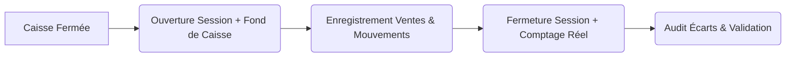

# Gestion & Suivi de Caisse (Sessions)

Pour assurer une traçabilité totale des espèces et éviter les erreurs de caisse ou les fraudes, ModaDZ intègre un système complet de **Gestion de Caisse (Sessions)**. Chaque opérateur de caisse travaille au sein d'une session fermée et auditable.

---

## 1. Cycle de vie d'une Session de Caisse

Chaque journée de travail ou changement d'équipe suit un cycle structuré :

### Ouverture de Caisse
Au début de sa journée, le caissier doit ouvrir sa session :
1. Une invite s'affiche demandant le **Fond de caisse** (le montant initial en espèces dans le tiroir, ex: *5 000 DA*).
2. Saisissez le montant et ajoutez une note si nécessaire.
3. Validez pour déverrouiller l'accès au Point de Vente (POS).

---

## 2. Enregistrement des Mouvements de Fonds

Pendant que la session est ouverte, le solde attendu en caisse évolue selon deux types d'opérations :

### Mouvements Automatiques
- **Ventes** : Chaque règlement en espèces augmente le solde de la caisse.
- **Remboursements** : Les retours clients en espèces diminuent le solde.
- **Dettes** : Les versements de crédit client en espèces augmentent le solde.
- **Dettes Fournisseurs** : Les versements de dettes fournisseurs en espèces diminuent le solde.

### Mouvements Manuels (Entrées/Sorties de Coffre)
Pour ajuster le liquide disponible ou régler de petites dépenses courantes :
1. Allez dans **Caisse > Nouveau Mouvement**.
2. Sélectionnez le type :
   - **Entrée (Apport)** : Ajout de monnaie dans le tiroir (ex: *+3 000 DA*).
   - **Sortie (Retrait)** : Dépôt d'espèces vers le coffre-fort principal (ex: *-20 000 DA*).
   - **Dépense** : Achat immédiat de petites fournitures (café, papier) depuis la caisse.
   - **Règlement Fournisseur** : Paiement en direct d'un coursier de livraison.
3. Saisissez le montant, le motif obligatoire (ex: *Achat timbres* ou *Dépôt banque*), puis validez.

---

## 3. Fermeture de Caisse & Comptage

En fin de service, le caissier doit fermer et déclarer ses comptes :
1. Allez dans **Caisse > Fermer la caisse**.
2. Le système affiche le montant total de ventes et retraits théoriques, mais cache ou affiche le solde attendu.
3. Le caissier compte physiquement l'argent liquide présent dans son tiroir et saisit le **Montant Réel**.
4. Saisissez des notes de clôture (ex: *Erreur rendu monnaie client de midi*).
5. Validez. La caisse est fermée et le Point de Vente se reverrouille.

---

## 4. Analyse des Écarts (Audit Manager)

Dès qu'une caisse est fermée, ModaDZ calcule l'écart de caisse :

$$\text{Écart (Différence)} = \text{Montant Réel Déclaré} - \text{Montant Attendu Théorique}$$

- **Écart de 0 DA** : Caisse parfaite (équilibre).
- **Écart Positif** : Excédent de caisse (surplus d'argent non expliqué).
- **Écart Négatif** : Manquant de caisse (perte ou erreur de monnaie).

Les gestionnaires et administrateurs peuvent consulter l'historique complet des sessions fermées, trier par caissier, et inspecter les mouvements détaillés d'une session suspecte pour repérer les anomalies de caisse.
